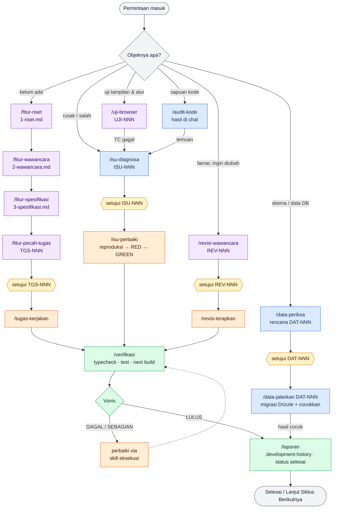
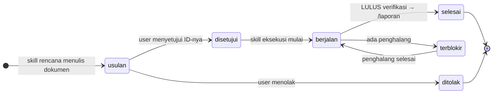

# .claude — Konfigurasi Claude Code SDIT AT-TAQWIM

Sumber kebenaran skill & rules untuk Claude Code pada sistem **SDIT AT-TAQWIM — Sistem SPP & Kelayakan Ujian**.
Stack resmi: **Next.js 15 (App Router)**, **React 19**, **TypeScript**, **Drizzle ORM**, **Neon PostgreSQL**, dan **Private Vercel Blob**.

---

## 1. Sistem Objek & Penamaan

Setiap pekerjaan dikelompokkan ke dalam tepat satu **objek**. Nama skill = `[objek]-[aksi]`, dan awalan skill = awalan ID = nama folder.
Aturan lengkap: [`rules/alur-kerja.md`](rules/alur-kerja.md).

| Objek | Kapan Digunakan | ID | Direktori Dokumen |
|---|---|---|---|
| **Fitur** | Kemampuan baru yang belum ada di sistem | `slug` kebab-case | `docs/fitur/[slug]/` |
| **Tugas** | Potongan kerja vertikal (*vertical slice*) dari fitur | `TGS-NNN` | `docs/fitur/[slug]/tugas/TGS-NNN-[nama].md` |
| **Isu** | Fitur sudah ada, tapi rusak/salah/bug | `ISU-NNN` | `docs/isu/ISU-NNN-[nama]/` |
| **Revisi** | Fitur sudah ada dan benar, tetapi ingin diubah alurnya | `REV-NNN` | `docs/revisi/REV-NNN-[nama].md` |
| **Data** | Perubahan skema atau migrasi data PostgreSQL | `DAT-NNN` | `docs/data/DAT-NNN-[nama].md` |
| **Uji** | Uji live browser (Playwright) | `UJI-NNN` (`TC-NN`) | `docs/uji/UJI-NNN-[menu]/` |

---

## 2. Siklus Pengerjaan (Peta Alur)

Setiap permintaan masuk diklasifikasikan berdasarkan objeknya, lalu mengikuti siklus:
**Rencana → Persetujuan Pengguna → Eksekusi → Verifikasi → Laporan.**

---

## 3. Siklus Status Dokumen

Berlaku untuk `TGS`, `ISU` (`rencana-perbaikan.md`), `REV`, `DAT`, dan `UJI`:

---

## 4. Daftar Skill (`commands/`)

| Kelompok | Skill | Fungsi | Hak Akses |
|---|---|---|---|
| **Fitur** | `/fitur-riset` | Riset codebase & dokumen sistem → `1-riset.md` | Tulis docs |
| | `/fitur-wawancara` | Wawancara terstruktur + rekomendasi terbaik → `2-wawancara.md` | Tulis docs |
| | `/fitur-spesifikasi` | Spesifikasi final fitur sekolah → `3-spesifikasi.md` | Tulis docs |
| | `/fitur-pecah-tugas` | Pecah spesifikasi jadi potongan tugas vertical slice `TGS-NNN` | Tulis docs |
| **Tugas** | `/tugas-kerjakan` | Kerjakan satu TGS yang disetujui (mendukung mode batch) | Ubah source |
| **Isu** | `/isu-diagnosa` | Telusuri akar masalah bug sampai baris file | **Read-only** |
| | `/isu-perbaiki` | Perbaiki bug yang disetujui (reproduksi → test regresi RED → GREEN) | Ubah source |
| **Revisi** | `/revisi-wawancara` | Rekam kebutuhan revisi alur existing → `REV-NNN` | Tulis docs |
| | `/revisi-terapkan` | Terapkan revisi yang disetujui | Ubah source |
| **Data** | `/data-periksa` | Periksa skema/data DB dev → rencana migrasi `DAT-NNN` | **Read-only** |
| | `/data-jalankan` | Jalankan migrasi Drizzle/script DAT yang disetujui | Ubah DB dev |
| | `/db-bandingkan` | Bandingkan skema `schema.ts` terhadap migrasi | **Read-only** |
| | `/db-sinkron` | Terapkan migrasi tertunda ke DB development | Ubah DB dev |
| **Uji** | `/uji-browser` | Test case P0–P5, Playwright Chromium, tangkapan layar | Baca & UI |
| **Verifikasi** | `/verifikasi` | Jalankan `typecheck`, `test` (PGlite), `next build`, audit diff | Baca & Run |
| | `/laporan` | Tutup tiket ke `.development-history/` dan status selesai | Tulis docs |
| **Audit** | `/audit-kode` | Sapuan bug berisiko, celah otorisasi, dan debt (di chat) | Read-only |
| | `/audit-progres` | Evaluasi kelengkapan menu & modul SDIT AT-TAQWIM (di chat) | Read-only |
| | `/logging` | Panduan audit trail tabel `audit_logs` dan larangan log rahasia | — |

---

## 5. Daftar Aturan Baku (`rules/`)

- [`alur-kerja.md`](rules/alur-kerja.md): Konvensi objek, ID, status, dan aturan persetujuan pengguna.
- [`project-context.md`](rules/project-context.md): Konteks arsitektur Next.js 15, batasan scope, dan hard rules.
- [`kelayakan-dan-keuangan.md`](rules/kelayakan-dan-keuangan.md): Logika SPP, evaluasi ujian 3-syarat, dispensasi, dan kartu QR.
- [`backend-serverless.md`](rules/backend-serverless.md): Route Handlers Next.js, Web Fetch API, Drizzle ORM, autentikasi HMAC, dan Vercel Blob.
- [`database.md`](rules/database.md): Standar Drizzle ORM, migrasi PostgreSQL Neon, transaksi, dan isolasi PGlite.
- [`frontend-react.md`](rules/frontend-react.md): Standar Next.js App Router, React 19, komponen modular, dan client API helper.
- [`form.md`](rules/form.md): Standar form `DataForm`, `Field`, `Modal`, validasi input nominal dan berkas.
- [`list-table.md`](rules/list-table.md): Standar tabel `DataTable`, filter pencarian, dan badge semantik.
- [`display-formatting.md`](rules/display-formatting.md): Format mata uang `money()`, status sekolah, tanggal WIB, dan normalisasi telepon.
- [`tests.md`](rules/tests.md): Pengujian unit `node:test` berfokus pada logika risiko tinggi dengan database PGlite.
- [`logging.md`](rules/logging.md): Pencatatan audit trail ke tabel `audit_logs` dan larangan kebocoran data rahasia.
