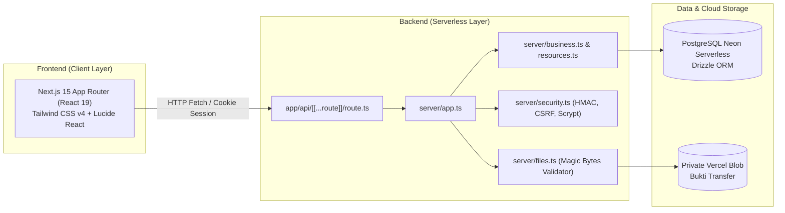
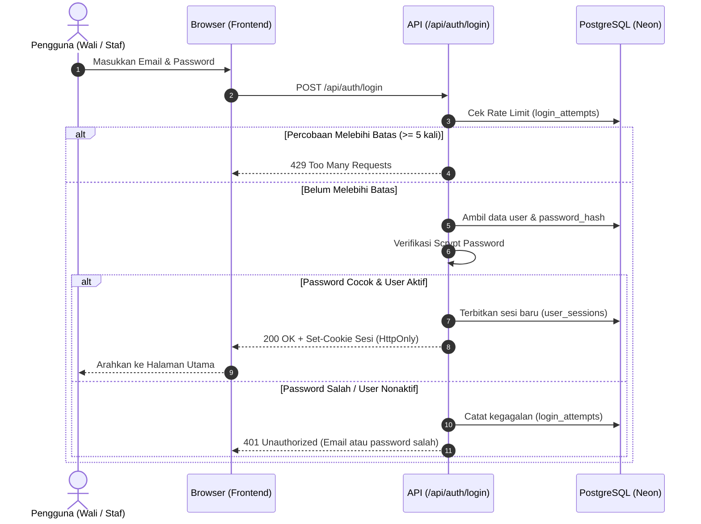
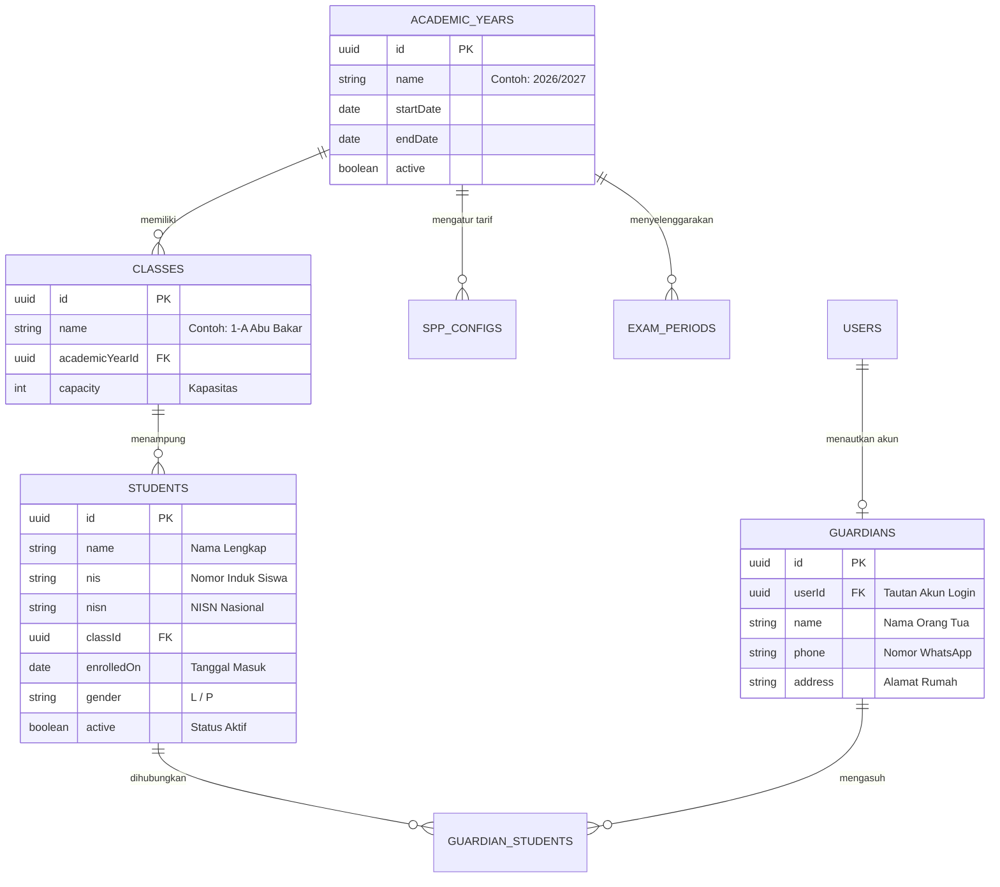
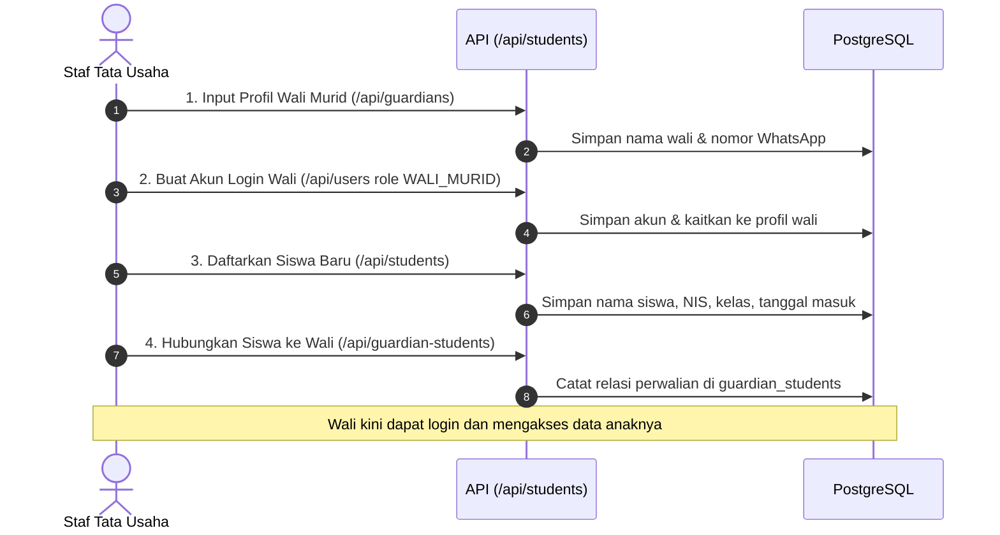
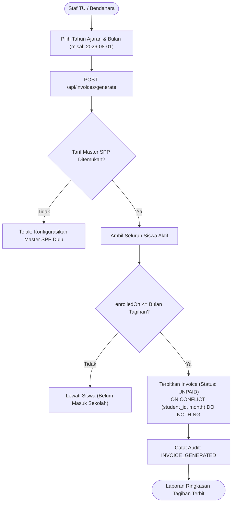
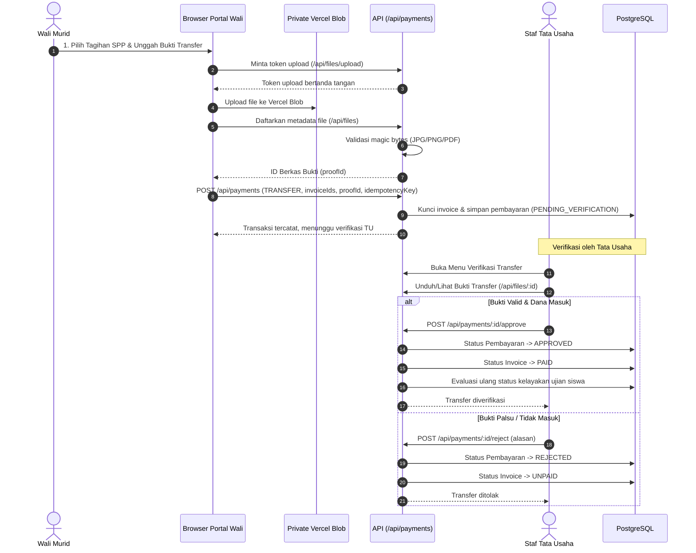
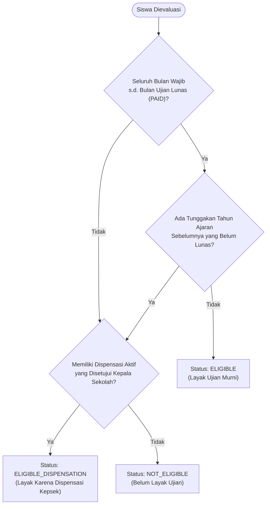
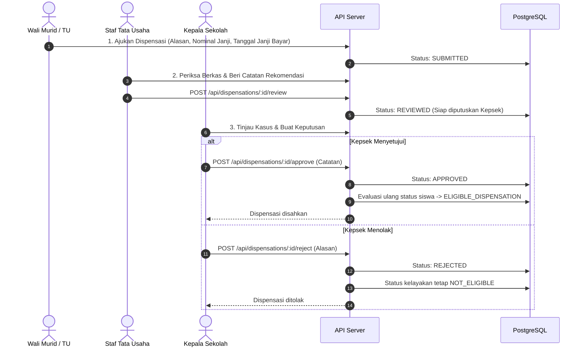
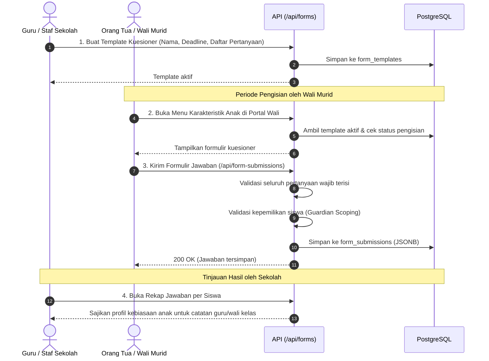

# Dokumentasi Lengkap Modul Sistem — SDIT AT-TAQWIM
### Sistem Administrasi SPP & Kelayakan Ujian Berbasis Next.js 15, Drizzle ORM, Neon PostgreSQL, dan Private Vercel Blob

---

## Daftar Isi
1. [Gambaran Umum & Arsitektur Sistem](#1-gambaran-umum--arsitektur-sistem)
   - [Latar Belakang & Tujuan](#latar-belakang--tujuan)
   - [Matriks Hak Akses Peran (RBAC)](#matriks-hak-akses-peran-rbac)
   - [Diagram Arsitektur Teknologi](#diagram-arsitektur-teknologi)
2. [Modul 01: Autentikasi & Hak Akses (RBAC)](#2-modul-01-autentikasi--hak-akses-rbac)
   - [Mekanisme Keamanan & Anti-IDOR](#mekanisme-keamanan--anti-idor)
   - [Alur Proses Login & Ganti Password](#alur-proses-login--ganti-password)
   - [Kamus Data & Spesifikasi API Endpoint](#kamus-data--spesifikasi-api-endpoint-autentikasi)
3. [Modul 02: Master Data Sekolah](#3-modul-02-master-data-sekolah)
   - [Aturan Bisnis & Proteksi Foreign Key](#aturan-bisnis--proteksi-foreign-key)
   - [Diagram Relasi Entitas (ERD)](#diagram-relasi-entitas-erd)
   - [Alur Pendaftaran Siswa & Penautan Wali](#alur-pendaftaran-siswa--penautan-wali)
   - [Kamus Data & Spesifikasi API Endpoint](#kamus-data--spesifikasi-api-endpoint-master-data)
4. [Modul 03: Keuangan & SPP Bulanan](#4-modul-03-keuangan--spp-bulanan)
   - [Aturan Finansial & Invarian Tagihan](#aturan-finansial--invarian-tagihan)
   - [Alur Generate Tagihan & Pembayaran Kasir](#alur-generate-tagihan--pembayaran-kasir)
   - [Alur Pembayaran Transfer & Verifikasi TU](#alur-pembayaran-transfer--verifikasi-tu)
   - [Format Pengingat WhatsApp Dinamis](#format-pengingat-whatsapp-dinamis)
   - [Kamus Data & Spesifikasi API Endpoint](#kamus-data--spesifikasi-api-endpoint-keuangan)
5. [Modul 04: Kelayakan Ujian & Kartu Ber-QR](#5-modul-04-kelayakan-ujian--kartu-ber-qr)
   - [Logika 3 Syarat Kelayakan Deterministik](#logika-3-syarat-kelayakan-deterministik)
   - [Alur Pengajuan & Otorisasi Dispensasi Kepala Sekolah](#alur-pengajuan--otorisasi-dispensasi-kepala-sekolah)
   - [Penerbitan & Validasi Kartu Ujian Ber-QR](#penerbitan--validasi-kartu-ujian-ber-qr)
   - [Kamus Data & Spesifikasi API Endpoint](#kamus-data--spesifikasi-api-endpoint-ujian)
6. [Modul 05: Karakteristik Siswa & Form Dinamis](#6-modul-05-karakteristik-siswa--form-dinamis)
   - [Konsep Form Dinamis Berbasis JSONB](#konsep-form-dinamis-berbasis-jsonb)
   - [Alur Pengisian Instrumen Karakter Siswa](#alur-pengisian-instrumen-karakter-siswa)
   - [Kamus Data & Spesifikasi API Endpoint](#kamus-data--spesifikasi-api-endpoint-form)
7. [Modul 06: Laporan Keuangan & Audit Trail](#7-modul-06-laporan-keuangan--audit-trail)
   - [Rekapitulasi Keuangan & Ekspor CSV](#rekapitulasi-keuangan--ekspor-csv)
   - [Tampilan Siap Cetak & PDF (@media print)](#tampilan-siap-cetak--pdf-media-print)
   - [Pencatatan Audit Trail Sistem (audit_logs)](#pencatatan-audit-trail-sistem-audit_logs)
   - [Kamus Data & Spesifikasi API Endpoint](#kamus-data--spesifikasi-api-endpoint-laporan)
8. [Modul 07: Infrastruktur & Keamanan Sistem](#8-modul-07-infrastruktur--keamanan-sistem)
   - [Spesifikasi Komponen Stack Serverless](#spesifikasi-komponen-stack-serverless)
   - [Protokol Penyimpanan Bukti Privat (Vercel Blob)](#protokol-penyimpanan-bukti-privat-vercel-blob)
   - [Prosedur Validasi Preflight Check](#prosedur-validasi-preflight-check)
   - [Daftar Perintah Operasional CLI](#daftar-perintah-operasional-cli)

---

# 1. Gambaran Umum & Arsitektur Sistem

### Latar Belakang & Tujuan
**Sistem SPP & Kelayakan Ujian SDIT AT-TAQWIM** dikembangkan untuk mentransformasi tata kelola administrasi sekolah dari sistem semi-manual menjadi sistem terpadu berbasis cloud serverless. Sistem ini memastikan ketertiban pembayaran iuran sekolah (SPP), memberikan transparansi evaluasi kelayakan siswa dalam mengikuti ujian, menyediakan alur resmi permohonan dispensasi kepada Kepala Sekolah, dan memudahkan orang tua/wali murid memantau administrasi anak-anaknya secara online.

### Matriks Hak Akses Peran (RBAC)
Sistem menerapkan pembatasan hak akses berbasis peran (*Role-Based Access Control*):

| Fitur / Modul | SUPER_ADMIN | TU / BENDAHARA | KEPALA_SEKOLAH | WALI_MURID |
|---|:---:|:---:|:---:|:---:|
| **Dashboard Ringkasan** | ✅ Seluruh Sekolah | ✅ Seluruh Sekolah | ✅ Seluruh Sekolah | ✅ Siswa Terkait Saja |
| **Master Siswa, Kelas, Wali** | ✅ Baca / Tulis | ✅ Baca / Tulis | 👁️ Hanya Lihat | ❌ Tidak Ada Akses |
| **Master Tarif SPP** | ✅ Baca / Tulis | ✅ Baca / Tulis | 👁️ Hanya Lihat | ❌ Tidak Ada Akses |
| **Generate Tagihan Bulanan** | ✅ Eksekusi | ✅ Eksekusi | 👁️ Hanya Lihat | ❌ Tidak Ada Akses |
| **Catat Pembayaran Tunai (CASH)** | ✅ Eksekusi | ✅ Eksekusi | ❌ Tidak Ada | ❌ Tidak Ada |
| **Unggah Bukti Transfer Bank** | ✅ Boleh | ✅ Boleh | ❌ Tidak Ada | ✅ Siswa Terkait Saja |
| **Verifikasi Bukti Transfer** | ✅ Setujui / Tolak | ✅ Setujui / Tolak | 👁️ Hanya Lihat | ❌ Tidak Ada Akses |
| **Pengajuan Dispensasi** | ✅ Boleh | ✅ Bantu Ajukan | ❌ Tidak Ada | ✅ Siswa Terkait Saja |
| **Review Awal Dispensasi (TU)** | ✅ Boleh | ✅ Verifikasi | ❌ Tidak Ada | ❌ Tidak Ada |
| **Persetujuan Dispensasi (Kepsek)** | ✅ Boleh | ❌ Dilarang | ✅ Sahkan / Tolak | ❌ Tidak Ada Akses |
| **Unduh Kartu Ujian Ber-QR** | ✅ Siswa Layak | ✅ Siswa Layak | ✅ Siswa Layak | ✅ Siswa Terkait yang Layak |
| **Validasi Kode QR Kartu** | ✅ Scan & Validasi | ✅ Scan & Validasi | ✅ Scan & Validasi | ❌ Hanya Tampilan |
| **Audit Log Sistem** | ✅ Lihat Log Lengkap | ❌ Dilarang | ❌ Dilarang | ❌ Dilarang |

### Diagram Arsitektur Teknologi



---

# 2. Modul 01: Autentikasi & Hak Akses (RBAC)

Modul ini mengelola pendaftaran sesi, verifikasi identitas pengguna, pengelolaan kata sandi dengan algoritma kriptografi modern, pembagian hak akses (*Role-Based Access Control*), serta proteksi data siswa antar-wali murid (*Guardian Scoping*).

### Mekanisme Keamanan & Anti-IDOR

1. **Proteksi Guardian Scoping (Anti-IDOR):**
   - Pengguna dengan peran `WALI_MURID` dibatasi mutlak oleh relasi pada tabel `guardian_students`.
   - Di setiap endpoint (seperti tagihan, kartu ujian, dan pengisian form), server selalu menyaring:
     ```sql
     WHERE student_id IN (
       SELECT student_id FROM guardian_students WHERE guardian_id = :authenticatedGuardianId
     )
     ```
   - Upaya pengaksesan ID siswa milik orang tua lain otomatis ditolak dengan `403 Forbidden`.
2. **Kriptografi Kata Sandi (Scrypt):**
   - Password di-hash menggunakan algoritma `crypto.scrypt` dengan salt 16-byte acak yang unik per pengguna.
   - **Anti-Timing Attack:** Pengecekan password dummy dijalankan bahkan ketika email tidak ditemukan di database agar waktu komputasi konstan (*username enumeration protection*).
3. **Pembatasan Percobaan Login (Rate Limiting):**
   - Maksimal 5 kali kegagalan login berturut-turut per alamat IP dan per akun email dalam rentang 15 menit. Melampaui batas akan memicu HTTP `429 Too Many Requests`.
4. **Sesi Cookie HMAC SHA-256:**
   - Token sesi acak 32-byte disimpan dalam bentuk hash HMAC di tabel `user_sessions`.
   - Cookie diset dengan atribut: `HttpOnly`, `SameSite=Lax`, `Secure` (production), dengan masa berlaku 8 jam.
   - Mengubah kata sandi otomatis mencabut (*revoke*) seluruh sesi aktif pengguna di perangkat lain.

### Alur Proses Login & Ganti Password



### Kamus Data & Spesifikasi API Endpoint (Autentikasi)

**Tabel Database:**
- `users`: Identitas akun pengguna (`id`, `name`, `email`, `password_hash`, `active`).
- `roles` & `permissions`: Master peran dan izin sistem.
- `user_sessions`: Sesi login aktif (`token_hash`, `expires_at`, `user_id`).
- `login_attempts`: Riwayat kegagalan login (`email`, `ip`, `attempted_at`).

**Spesifikasi Endpoint:**

| Method | Endpoint | Hak Akses | Deskripsi & Payload |
|---|---|---|---|
| `POST` | `/api/auth/login` | Publik | Masuk sistem. Body: `{ "email": "...", "password": "..." }`. Menghasilkan cookie HttpOnly. |
| `GET` | `/api/auth/me` | Sesi Login | Mengambil profil user aktif, peran, dan permissions yang dimiliki. |
| `POST` | `/api/auth/password` | Sesi Login | Mengubah kata sandi. Body: `{ "currentPassword": "...", "newPassword": "..." }`. Mencabut semua sesi lain. |
| `POST` | `/api/auth/logout` | Sesi Login | Mengakhiri sesi login dan menghapus token di database. |

---

# 3. Modul 02: Master Data Sekolah

Modul ini bertanggung jawab atas data pondasi akademik: Tahun Ajaran, Kelas, Data Siswa, Data Wali Murid, serta relasi perwalian.

### Aturan Bisnis & Proteksi Foreign Key

1. **Proteksi Integritas Transaksi (Non-Negotiable):**
   - Data **Siswa**, **Kelas**, atau **Tahun Ajaran** yang sudah memiliki riwayat tagihan (`invoices`), histori pembayaran (`payments`), atau evaluasi ujian **DILARANG DIHAPUS**.
   - Database dilindungi oleh Foreign Key Constraint tanpa cascade delete. Upaya penghapusan data terkait transaksi menghasilkan respon `400 Bad Request`.
2. **Kunci Tanggal Masuk Siswa (`enrolledOn`):**
   - Menentukan batas awal kewajiban SPP siswa. Siswa yang masuk di pertengahan tahun ajaran (misal: bulan Oktober) tidak dibebani tagihan bulan Juli–September.
3. **Multi-Siswa per Wali Murid:**
   - Satu orang tua dapat memiliki lebih dari satu anak yang bersekolah di SDIT AT-TAQWIM (misal: Kelas 1 dan Kelas 4) dalam satu akun login tunggal melalui tabel penghubung `guardian_students`.

### Diagram Relasi Entitas (ERD)



### Alur Pendaftaran Siswa & Penautan Wali



### Kamus Data & Spesifikasi API Endpoint (Master Data)

**Tabel Database:**
- `academic_years`: Tahun ajaran (`name`, `start_date`, `end_date`, `active`).
- `classes`: Rombongan belajar / kelas (`name`, `academic_year_id`, `capacity`).
- `students`: Data siswa (`name`, `nis`, `nisn`, `class_id`, `gender`, `enrolled_on`, `active`).
- `guardians`: Data orang tua/wali (`name`, `phone`, `address`, `user_id`).
- `guardian_students`: Relasi tabel perwalian (`guardian_id`, `student_id`).

**Spesifikasi Endpoint:**

| Method | Endpoint | Hak Akses | Deskripsi & Payload |
|---|---|---|---|
| `GET` | `/api/academic-years` | Sesi Login | Mengambil daftar seluruh tahun ajaran. |
| `POST` | `/api/academic-years` | Permission: `master` | Menambah tahun ajaran baru. Body: `{ "name": "2026/2027", "startDate": "...", "endDate": "..." }`. |
| `GET` | `/api/classes` | Sesi Login | Mengambil daftar kelas dan kapasitasnya. |
| `POST` | `/api/classes` | Permission: `master` | Menambah kelas baru. Body: `{ "name": "1-A Abu Bakar", "academicYearId": "...", "capacity": 28 }`. |
| `GET` | `/api/students` | Sesi Login | Mengambil daftar siswa (otomatis terfilter jika login sebagai wali). |
| `POST` | `/api/students` | Permission: `master` | Menambah siswa baru. Body: `{ "name": "...", "nis": "...", "classId": "...", "enrolledOn": "YYYY-MM-DD" }`. |
| `PATCH` | `/api/students/:id` | Permission: `master` | Memperbarui data siswa. |
| `DELETE` | `/api/students/:id` | Permission: `master` | Menghapus data siswa (ditolak jika memiliki transaksi). |
| `POST` | `/api/guardian-students` | Permission: `master` | Menautkan perwalian orang tua ke siswa. Body: `{ "guardianId": "...", "studentId": "..." }`. |

---

# 4. Modul 03: Keuangan & SPP Bulanan

Modul Keuangan mengelola siklus pendapatan SPP: konfigurasi tarif, generate tagihan, kasir tunai, pembayaran transfer bank, verifikasi bukti transfer di Vercel Blob, serta pengingat WhatsApp.

### Aturan Finansial & Invarian Tagihan

1. **Snapshot Nominal Permanen (*Immutable Invoices*):**
   - Perubahan nominal SPP pada Master SPP **TIDAK BOLEH** mengubah invoice lama yang sudah terbit.
   - Tagihan yang sudah diterbitkan (`invoices`) mengunci nominal pada saat generate (`amount`).
2. **Kalkulasi Nominal Terpusat di Server:**
   - Client **TIDAK BOLEH** mengirimkan nominal total pembayaran (`amount`).
   - Client hanya mengirim daftar ID invoice yang dipilih (`invoiceIds`). Server menjumlahkan nominal aktual dari database di dalam transaksi tertutup.
3. **Idempotensi Pembayaran (*Anti-Double Charge*):**
   - Setiap upaya pembayaran menyertakan `idempotencyKey` (UUID unik).
   - Pengiriman ulang dengan key yang sama mengembalikan transaksi semula tanpa menduplikasi data transaksi.
4. **Verifikasi Bukti Transfer oleh TU:**
   - Pembayaran transfer berstatus `PENDING_VERIFICATION` dan wajib melampirkan berkas bukti (`proofId`).
   - Tagihan terkait juga dikunci menjadi `PENDING_VERIFICATION` agar tidak dibayar ganda.
   - **Disetujui (Approve):** Invoice menjadi `PAID`, pembayaran `APPROVED`, dan memicu evaluasi ulang kelayakan ujian.
   - **Ditolak (Reject):** Invoice kembali `UNPAID` (atau `OVERDUE`), status bukti ditandai ditolak beserta alasan tertulis dari TU.

### Alur Generate Tagihan & Pembayaran Kasir



### Alur Pembayaran Transfer & Verifikasi TU



### Format Pengingat WhatsApp Dinamis
Sistem menghasilkan format tautan WhatsApp interaktif tanpa gateway eksternal berbayar:
```text
https://wa.me/6281234567890?text=Assalamu%27alaikum%20Warahmatullahi%20Wabarakatuh.%0AYth.%20Orang%20Tua%2FWali%20dari%20Ahmad%20Fadhil%20Pratama%20(Kelas%201-A%20Abu%20Bakar).%0A%0AMengingatkan%20bahwa%20terdapat%20tunggakan%20SPP%20sebesar%20Rp700.000%20untuk%20bulan%20Juli%202026%2C%20Agustus%202026.%0A%0AMohon%20dapat%20melakukan%20pembayaran%20sebelum%20ujian%20dimulai.%20Terima%20kasih.
```

### Kamus Data & Spesifikasi API Endpoint (Keuangan)

**Tabel Database:**
- `spp_configs`: Tarif SPP tahun ajaran (`academic_year_id`, `amount`, `active`).
- `invoices`: Lembar tagihan siswa (`student_id`, `academic_year_id`, `month`, `amount`, `status`).
- `payments`: Histori transaksi (`student_id`, `method`, `status`, `proof_id`, `paid_on`, `idempotency_key`).
- `payment_items`: Relasi pelunasan tagihan (`payment_id`, `invoice_id`, `amount`).
- `files`: Metadata berkas bukti transfer (`pathname`, `size`, `mime`, `created_by`).

**Spesifikasi Endpoint:**

| Method | Endpoint | Hak Akses | Deskripsi & Payload |
|---|---|---|---|
| `GET` | `/api/invoices` | Sesi Login | Mengambil daftar tagihan SPP (otomatis ter-filter per wali). |
| `POST` | `/api/invoices/generate` | Permission: `finance` | Menerbitkan tagihan bulanan. Body: `{ "academicYearId": "...", "month": "YYYY-MM-01" }`. |
| `GET` | `/api/payments` | Sesi Login | Mengambil riwayat pembayaran. |
| `POST` | `/api/payments` | Sesi Login | Mencatat pembayaran baru. Body: `{ "studentId": "...", "invoiceIds": [...], "method": "CASH"|"TRANSFER", "idempotencyKey": "..." }`. |
| `POST` | `/api/payments/:id/approve`| Permission: `finance` | Staf TU menyetujui transfer bank. Melunasi invoice terkait. |
| `POST` | `/api/payments/:id/reject` | Permission: `finance` | Staf TU menolak transfer bank dengan alasan tertulis. |
| `GET` | `/api/students/:id/reminder` | Permission: `finance` | Menghasilkan tautan pesan WhatsApp penagihan tunggakan siswa. |

---

# 5. Modul 04: Kelayakan Ujian & Kartu Ber-QR

Modul Kelayakan Ujian mengotomatisasi evaluasi syarat administratif ujian (PTS, PAS, atau PAT), memfasilitasi pengajuan dispensasi berjenjang ke Kepala Sekolah, dan menerbitkan kartu ujian digital ber-QR Code dengan validasi real-time.

### Logika 3 Syarat Kelayakan Deterministik

Evaluasi kelayakan siswa dihitung oleh fungsi murni `evaluate(requiredMonths, invoices, hasApprovedDispensation)`:



1. **Lunas Bulan Wajib Ujian:** Seluruh invoice wajib sejak siswa terdaftar hingga bulan ujian berstatus `PAID`.
2. **Bebas Tunggakan Lama:** Tidak memiliki invoice yang tertunggak pada tahun ajaran terdahulu.
3. **Pengecualian via Dispensasi Kepala Sekolah:** Siswa yang belum memenuhi syarat 1 atau 2 tetap dinyatakan berhak mengikuti ujian dengan status `ELIGIBLE_DISPENSATION` jika memiliki permohonan dispensasi resmi yang disetujui Kepala Sekolah.

### Alur Pengajuan & Otorisasi Dispensasi Kepala Sekolah



> **Catatan Penting:** Dispensasi ujian **TIDAK MENGHAPUS** hutang tagihan SPP. Lembar invoice tetap tercatat sebagai piutang siswa yang wajib dilunasi sesuai tanggal janji bayar.

### Penerbitan & Validasi Kartu Ujian Ber-QR

1. **Hak Unduh Kartu:** Kartu ujian hanya dapat diunduh jika status siswa `ELIGIBLE` atau `ELIGIBLE_DISPENSATION` dan izin unduh periode ujian dibuka (`allowDownload = true`).
2. **Validasi Anti-Pemalsuan Real-Time:**
   - Kartu ujian memuat kode QR dengan UUID verifikasi acak (`verificationCode`).
   - Pada hari ujian, pengawas ruang ujian memindai kode QR melalui kamera atau memasukkan kode verifikasi pada portal staf:
     `GET /api/exam-cards/:code/validate`
   - Server mengevaluasi data siswa secara live saat discan. Jika terdapat pembatalan status kelayakan, sistem pengawas langsung memberikan sinyal merah bahwa kartu tidak valid.

### Kamus Data & Spesifikasi API Endpoint (Ujian)

**Tabel Database:**
- `exam_types`: Master jenis ujian (`name`, `code`).
- `exam_periods`: Periode ujian (`academic_year_id`, `exam_type_id`, `semester`, `start_date`, `deadline`, `required_month`, `allow_download`).
- `eligibilities`: Catatan kelayakan per siswa per ujian (`student_id`, `exam_period_id`, `status`, `evaluated_at`).
- `dispensations`: Dispensasi ujian (`student_id`, `exam_period_id`, `reason`, `amount`, `promised_on`, `status`, `reviewed_by`, `approved_by`).
- `exam_cards`: Penerbitan kartu ujian ber-QR (`student_id`, `exam_period_id`, `verification_code`, `issued_at`).

**Spesifikasi Endpoint:**

| Method | Endpoint | Hak Akses | Deskripsi & Payload |
|---|---|---|---|
| `POST` | `/api/exams/:id/eligibility` | Permission: `master`/`finance` | Mengevaluasi status kelayakan seluruh siswa untuk ujian tertentu. |
| `POST` | `/api/dispensations` | Wali Murid / TU | Mengajukan dispensasi ujian. Body: `{ "studentId": "...", "examPeriodId": "...", "reason": "...", "promisedOn": "YYYY-MM-DD" }`. |
| `POST` | `/api/dispensations/:id/review` | Permission: `finance` | Staf TU mereview permohonan dispensasi (mengubah status ke `REVIEWED`). |
| `POST` | `/api/dispensations/:id/approve`| Permission: `principal` (Kepsek) | Kepala Sekolah mengesahkan dispensasi siswa menjadi `APPROVED`. |
| `POST` | `/api/dispensations/:id/reject` | Permission: `principal` (Kepsek) | Kepala Sekolah menolak dispensasi siswa dengan alasan tertulis. |
| `POST` | `/api/exam-cards` | Sesi Login | Menerbitkan kartu ujian digital ber-QR bagi siswa yang memenuhi syarat. |
| `GET` | `/api/exam-cards/:code/validate`| Staf Sekolah | Pengawas ruang ujian memvalidasi kode QR kartu ujian secara live. |

---

# 6. Modul 05: Karakteristik Siswa & Form Dinamis

Modul Karakteristik Siswa dirancang khusus untuk memantau perkembangan adab, kebiasaan ibadah di rumah (shalat 5 waktu, tilawah Al-Qur'an), bakat minat, serta catatan medis khusus siswa melalui kuesioner dinamis.

### Konsep Form Dinamis Berbasis JSONB

1. **Pembuatan Template Fleksibel (`form_templates`):**
   - Guru atau staf sekolah dapat membuat instrumen kuesioner baru tanpa perlu mengubah kode sumber atau mengubah skema tabel database.
   - Setiap template memuat nama kuesioner, batas akhir pengisian (*deadline*), dan daftar pertanyaan dinamis (`fields: [{ id, label, required }]`).
2. **Penyimpanan Dokumen Fleksibel (`form_submissions`):**
   - Jawaban disimpan dalam kolom tipe `jsonb` PostgreSQL dengan struktur array pasangan `fieldId` dan `value`.
3. **Proteksi Pengisian:**
   - Server memverifikasi bahwa pengisi form adalah wali murid yang sah dari siswa terkait.

### Alur Pengisian Instrumen Karakter Siswa



### Kamus Data & Spesifikasi API Endpoint (Form)

**Tabel Database:**
- `form_templates`: Definisi instrumen kuesioner (`name`, `deadline`, `fields`: `jsonb`, `created_by`).
- `form_submissions`: Lembar jawaban respon siswa (`template_id`, `student_id`, `answers`: `jsonb`, `submitted_at`, `submitted_by`).

**Spesifikasi Endpoint:**

| Method | Endpoint | Hak Akses | Deskripsi & Payload |
|---|---|---|---|
| `POST` | `/api/forms` | Permission: `master` | Membuat template kuesioner baru. Body: `{ "name": "...", "deadline": "YYYY-MM-DD", "fields": [...] }`. |
| `POST` | `/api/form-submissions` | Wali Murid | Mengirimkan lembar jawaban kuesioner untuk siswa yang diasuh. |

---

# 7. Modul 06: Laporan Keuangan & Audit Trail

Modul ini menyediakan sarana transparansi, pelaporan manajerial kepada Yayasan dan Kepala Sekolah, ekspor data administratif, serta rekaman audit trail sistem untuk melacak setiap mutasi data sensitif.

### Rekapitulasi Keuangan & Ekspor CSV
- Menyajikan total penerimaan SPP (tunai dan transfer terverifikasi) per bulan dan tahun ajaran.
- Menampilkan persentase kelayakan ujian per kelas (`ELIGIBLE`, `ELIGIBLE_DISPENSATION`, `NOT_ELIGIBLE`).
- Seluruh tabel rekap dapat diekspor menjadi berkas `.csv` dengan pemformatan sel aman (`csvCell`) untuk mencegah formula injection pada spreadsheet.

### Tampilan Siap Cetak & PDF (@media print)
- Dilengkapi aturan stylesheet cetak `@media print` bawaan.
- Menekan tombol "Cetak / PDF" (`window.print()`) otomatis menyembunyikan sidebar, navbar, tombol aksi, dan pagination, menyisakan dokumen siap cetak yang rapi dengan kop sekolah.

### Pencatatan Audit Trail Sistem (`audit_logs`)
Setiap mutasi data sensitif (approve pembayaran, generate tagihan, dispensasi disetujui, perubahan setting akun) wajib dicatat secara otomatis ke tabel `audit_logs` melalui fungsi helper `audit()`.

Informasi yang otomatis direkam:
- **`action`**: Jenis aksi (`CREATE`, `UPDATE`, `DELETE`, `APPROVE`, `REJECT`).
- **`entity`**: Objek yang disentuh (`payment`, `invoice`, `student`, `dispensation`, `setting`).
- **`entityId`**: UUID objek yang dimodifikasi.
- **`userId`**: Identitas staf pemanggil.
- **`ip`** & **`userAgent`**: Alamat IP dan browser pengguna.
- **`before`** & **`after`**: Snapshot nilai lama dan nilai baru dalam format JSONB.
- **`createdAt`**: Waktu presisi kejadian dengan timezone.

> **Proteksi Keamanan:** Tabel audit log bersifat *append-only* (tidak ada fitur update/delete audit log). Layar audit log hanya dapat dibuka oleh akun dengan peran `SUPER_ADMIN` (permission `audit`).

### Kamus Data & Spesifikasi API Endpoint (Laporan)

**Tabel Database:**
- `audit_logs`: Log jejak audit sistem (`action`, `entity`, `entity_id`, `user_id`, `ip`, `user_agent`, `before`, `after`, `created_at`).

**Spesifikasi Endpoint:**

| Method | Endpoint | Hak Akses | Deskripsi & Payload |
|---|---|---|---|
| `GET` | `/api/reports/spp` | Permission: `finance` | Mengambil rekapitulasi data tagihan dan realisasi SPP per kelas. |
| `GET` | `/api/reports/eligibility` | Permission: `master`/`read` | Mengambil rekapitulasi status kelayakan siswa per kelas untuk ujian tertentu. |
| `GET` | `/api/audit-logs?page=1` | Permission: `audit` (`SUPER_ADMIN`) | Mengambil daftar jejak audit sistem berhalaman (50 log per batch). |

---

# 8. Modul 07: Infrastruktur & Keamanan Sistem

Modul ini mendokumentasikan spesifikasi infrastruktur serverless, manajemen basis data, protokol penyimpanan berkas privat, serta prosedur pengujian kehandalan sistem (*preflight check*).

### Spesifikasi Komponen Stack Serverless

| Komponen | Pilihan Teknologi | Versi / Spesifikasi | Peran dalam Sistem |
|---|---|---|---|
| **Frontend Framework** | Next.js (App Router) | v15+ | Framework SSR & Client Components terpadu |
| **UI Library** | React & React DOM | v19.2 | Rendering komponen interaktif antarmuka |
| **Styling** | Tailwind CSS & PostCSS | v4.1 | Utility-first styling dan print styling |
| **Ikon Antarmuka** | Lucide React | v0.577+ | Set ikon modern dan konsisten |
| **Backend Runtime** | Next.js Route Handlers | Node.js 24 | Web Fetch API (`Request` & `Response`) |
| **Database** | PostgreSQL (Neon Serverless) | v16 | Database relational transaksi sekolah |
| **ORM & Migrations** | Drizzle ORM & Drizzle Kit | v0.45 / v0.31 | Type-safe schema builder & migration runner |
| **Testing Engine** | Node Test Runner + PGlite | `@electric-sql/pglite` | Database PostgreSQL terisolasi untuk unit test |
| **Penyimpanan Berkas** | Private Vercel Blob | `@vercel/blob` | Penyimpanan cloud berkas bukti transfer SPP |
| **Validasi Skema** | Zod | v4.6+ | Runtime data validation untuk seluruh request payload |

### Protokol Penyimpanan Bukti Privat (Vercel Blob)

1. **Token Upload Bertanda Tangan:**
   - Client meminta token upload ke server (`POST /api/files/upload`).
   - Token dibatasi: kedaluwarsa 5 menit, ukuran maksimal 5 MB, batas 20 token per pengguna per jam, path terkunci di `proofs/${userId}/${uuid}.${ext}`.
2. **Validasi Signature Magic Bytes:**
   Setelah berkas terunggah, server mengunduh byte awal berkas untuk memvalidasi *magic bytes* secara biner:
   - JPEG: diawali byte `FF D8 FF`
   - PNG: diawali byte `89 50 4E 47`
   - PDF: diawali byte `%PDF-`
   Ekstensi palsu atau berkas berbahaya otomatis ditolak dan dihapus.
3. **Penyajian Terproteksi & Chunking:**
   - Berkas diakses melalui endpoint `/api/files/:id` dengan verifikasi sesi.
   - Respon mendukung HTTP Range Request (maksimal 2 MB per chunk) untuk efisiensi memori server.

### Prosedur Validasi Preflight Check
Sebelum aplikasi dideploy ke lingkungan produksi, jalankan skrip inspeksi kesiapan infrastruktur:
```sh
npm run preflight
```
Preflight memeriksa:
- Keberadaan variabel lingkungan penting (`DATABASE_URL`, `AUTH_SECRET`, `BLOB_READ_WRITE_TOKEN`, `APP_ORIGIN`).
- Panjang `AUTH_SECRET` minimal 32 karakter acak.
- Konektivitas ke basis data Neon PostgreSQL dan validasi keberadaan skema tabel `users`.
- Uji coba tulis, baca metadata, dan hapus berkas uji kesehatan (*health check*) pada private Vercel Blob.

### Daftar Perintah Operasional CLI

```sh
# Menjalankan server pengembangan terpadu (Port 3000)
npm run dev

# Memeriksa tipe data TypeScript
npm run typecheck

# Menjalankan seluruh pengujian unit & integrasi (PGlite terisolasi)
npm test

# Menghasilkan berkas migrasi SQL Drizzle baru dari schema.ts
npm run db:generate

# Menerapkan migrasi tertunda ke database development
npm run db:migrate

# Menginisialisasi role dan akun super admin awal
npm run db:init

# Melakukan kompilasi build produksi Next.js
npm run build

# Menjalankan server hasil build di lingkungan produksi
npm run start
```
