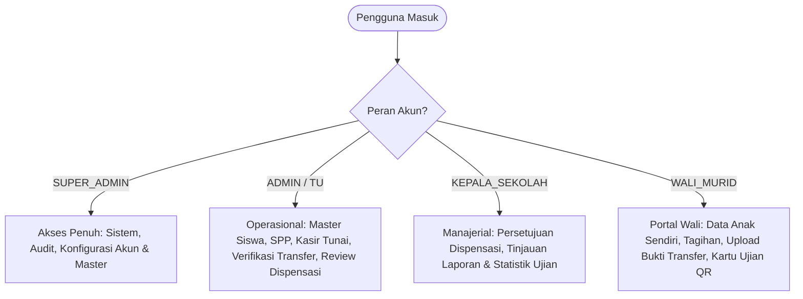
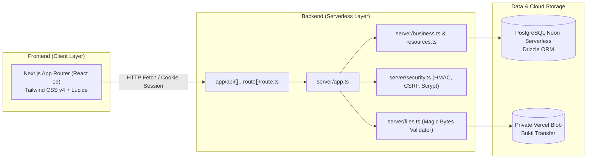

# Dokumentasi Modul Sistem — SDIT AT-TAQWIM

Selamat datang di dokumentasi resmi arsitektur dan modul bisnis **Sistem SPP & Kelayakan Ujian — SDIT AT-TAQWIM**.
Sistem ini dibangun untuk mendigitalisasi pengelolaan administrasi keuangan sekolah (SPP), evaluasi kelayakan ujian secara otomatis dan transparan, penerbitan kartu ujian ber-QR, serta portal pemantauan untuk wali murid.

---

## 1. Peta Modul Sistem

Dokumentasi modul disusun secara tematik per bounded-context bisnis:

| No | Modul | Berkas Panduan | Cakupan Utama |
|---|---|---|---|
| 01 | **Autentikasi & Hak Akses** | [`01-autentikasi-dan-peran.md`](01-autentikasi-dan-peran.md) | Manajemen peran (*RBAC*), sesi cookie HMAC, proteksi IDOR *Guardian Scoping*. |
| 02 | **Master Data Sekolah** | [`02-master-data.md`](02-master-data.md) | Manajemen Tahun Ajaran, Kelas, Siswa, Wali Murid, dan proteksi foreign key. |
| 03 | **Keuangan & SPP** | [`03-keuangan-dan-spp.md`](03-keuangan-dan-spp.md) | Master tarif SPP, generate invoice bulanan, pembayaran tunai/transfer, verifikasi bukti Blob, dan reminder WA. |
| 04 | **Kelayakan & Ujian** | [`04-kelayakan-dan-ujian.md`](04-kelayakan-dan-ujian.md) | Periode ujian, evaluasi 3 syarat kelayakan otomatis, permohonan dispensasi Kepala Sekolah, kartu QR. |
| 05 | **Karakteristik Anak** | [`05-karakteristik-anak.md`](05-karakteristik-anak.md) | Pembuatan template kuesioner dan instrumen penilaian karakter siswa oleh wali murid. |
| 06 | **Laporan & Audit Trail** | [`06-laporan-dan-audit.md`](06-laporan-dan-audit.md) | Rekapitulasi keuangan, ekspor CSV, layout siap cetak, dan pencatatan audit perubahan data. |
| 07 | **Infrastruktur & Keamanan** | [`07-infrastruktur-dan-keamanan.md`](07-infrastruktur-dan-keamanan.md) | Next.js 15 App Router, Drizzle ORM, Neon PostgreSQL, Private Vercel Blob, dan preflight check. |

---

## 2. Matriks Hak Akses Peran Pengguna (Role-Based Access)

Sistem membedakan akses data secara ketat berdasarkan peran akun:

| Fitur / Modul | SUPER_ADMIN | TU / BENDAHARA | KEPALA_SEKOLAH | WALI_MURID |
|---|:---:|:---:|:---:|:---:|
| **Dashboard Ringkasan** | ✅ Seluruh Sekolah | ✅ Seluruh Sekolah | ✅ Seluruh Sekolah | ✅ Terbatas Siswa Terkait |
| **Master Siswa, Kelas, Wali** | ✅ Baca / Tulis | ✅ Baca / Tulis | 👁️ Hanya Lihat | ❌ Tidak Ada Akses |
| **Master Tarif SPP** | ✅ Baca / Tulis | ✅ Baca / Tulis | 👁️ Hanya Lihat | ❌ Tidak Ada Akses |
| **Generate Tagihan Bulanan** | ✅ Eksekusi | ✅ Eksekusi | 👁️ Hanya Lihat | ❌ Tidak Ada Akses |
| **Catat Pembayaran Tunai (CASH)** | ✅ Eksekusi | ✅ Eksekusi | ❌ Tidak Ada | ❌ Tidak Ada |
| **Unggah Bukti Transfer Bank** | ✅ Boleh | ✅ Boleh | ❌ Tidak Ada | ✅ Siswa Terkait |
| **Verifikasi Bukti Transfer** | ✅ Setujui / Tolak | ✅ Setujui / Tolak | 👁️ Hanya Lihat | ❌ Tidak Ada Akses |
| **Pengajuan Dispensasi** | ✅ Boleh | ✅ Bantu Ajukan | ❌ Tidak Ada | ✅ Siswa Terkait |
| **Review Dispensasi (TU)** | ✅ Boleh | ✅ Verifikasi Awal | ❌ Tidak Ada | ❌ Tidak Ada |
| **Persetujuan Dispensasi (Kepsek)** | ✅ Boleh | ❌ Dilarang | ✅ Sahkan / Tolak | ❌ Tidak Ada Akses |
| **Unduh Kartu Ujian Ber-QR** | ✅ Siswa Layak | ✅ Siswa Layak | ✅ Siswa Layak | ✅ Siswa Terkait yang Layak |
| **Validasi Kode QR Kartu** | ✅ Scan & Validasi | ✅ Scan & Validasi | ✅ Scan & Validasi | ❌ Hanya Tampilan |
| **Audit Log Sistem** | ✅ Lihat Log Lengkap | ❌ Dilarang | ❌ Dilarang | ❌ Dilarang |

---

## 3. Diagram Arsitektur Aplikasi

---

## 4. Tautan Referensi Tambahan

- [Kontrak API Teknis](../API.md)
- [Panduan Deployment Vercel & Neon](../DEPLOYMENT.md)
- [Laporan Audit & Batas Verifikasi](../FINAL-REPORT.md)
- [Aturan Operasional Agen](../../.agents/rules/alur-kerja.md)
